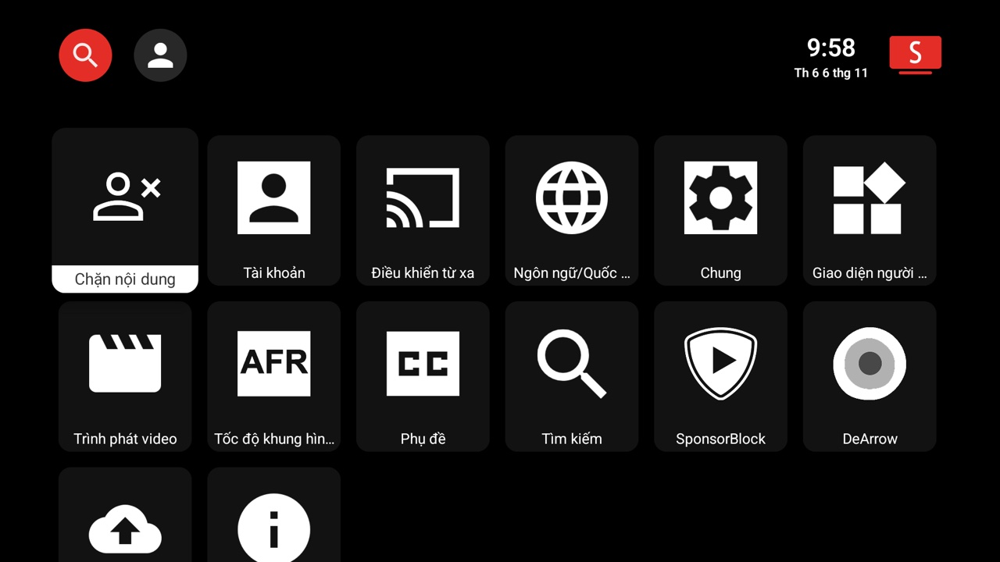
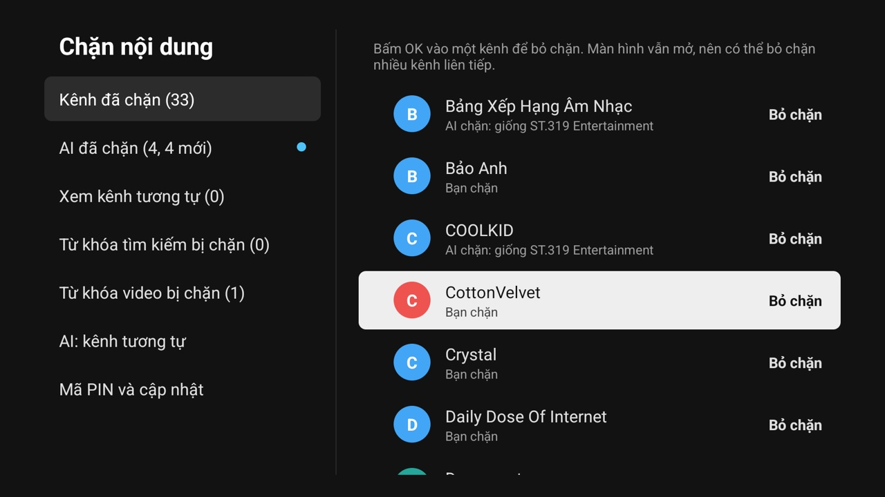
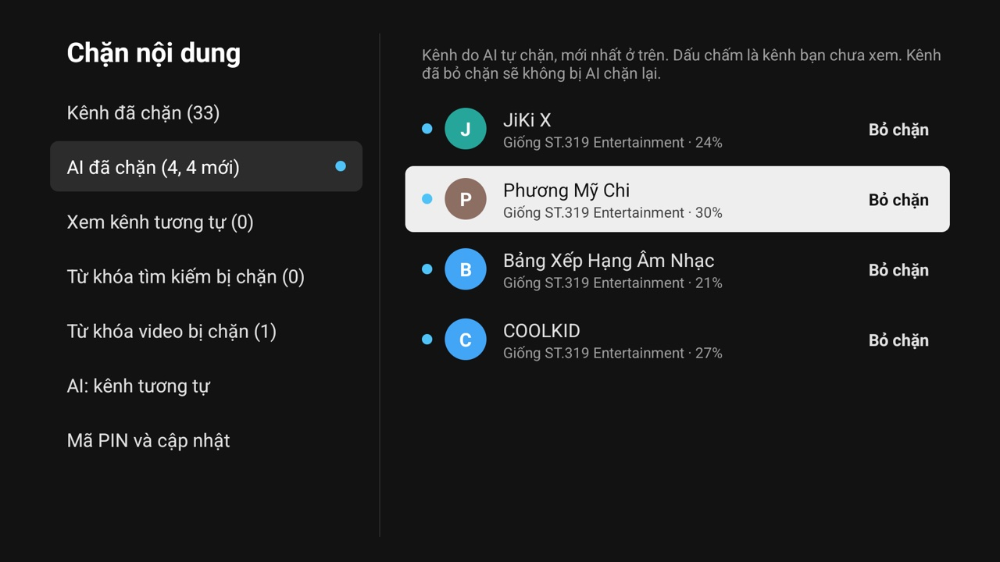

# BlockTube: TV nhà mình, nội dung mình chọn

BlockTube là trình xem video cho Android TV, dựa trên SmartTube, thêm bộ **Chặn nội dung**. Kênh nào không muốn thấy thì chặn, chủ đề nào không muốn con xem thì chặn theo từ khóa. AI sẽ tìm giúp những kênh tương tự.

## Mọi thứ ở một chỗ

Vào **Cài đặt → Chặn nội dung**. Toàn bộ phần này được khóa bằng **mã PIN 4 số**.

## Chặn kênh trong một nút bấm

Đang lướt mà gặp kênh không ưng: **nhấn giữ OK → Chặn kênh**. Mọi video của kênh đó biến mất ngay, kể cả video tự phát tiếp theo.

Muốn bỏ chặn thì vào **Kênh đã chặn** và bấm OK vào kênh. Màn hình vẫn mở, nên gỡ bao nhiêu kênh liền cũng được.

## Chặn theo từ khóa

- **Từ khóa tìm kiếm:** gõ từ có trong danh sách sẽ không ra kết quả nào.
- **Từ khóa video:** video và playlist có từ đó trong tiêu đề sẽ bị ẩn.

Không cần gõ dấu: "tro choi" chặn được cả "Trò Chơi".

## AI tìm kênh tương tự

Bật **AI: kênh tương tự** một lần (tải khoảng 120 MB). Từ đó, mỗi khi bạn chặn một kênh, AI tìm những kênh giống vậy và chặn luôn.

- Chọn **mức độ**: *Rất giống*, *Giống* hoặc *Hơi giống*. Kênh chưa đủ giống sẽ chờ bạn duyệt.
- **AI đã chặn** liệt kê từng kênh và giống kênh nào. Kênh mới có **dấu chấm xanh**.
- AI chặn nhầm thì bấm **Bỏ chặn**, AI sẽ không chặn lại kênh đó.

AI chạy ngay trên TV, chỉ làm việc khi không phát video. Danh sách chặn nằm trên TV, không gửi lên máy chủ nào.

## Luôn mới

Vào **Mã PIN và cập nhật → Kiểm tra bản cập nhật** để lên bản mới nhất. Danh sách chặn được giữ nguyên.

---

*BlockTube là dự án không chính thức, phát triển từ [SmartTube](https://github.com/yuliskov/SmartTube). Không liên kết với Google hay YouTube.*
